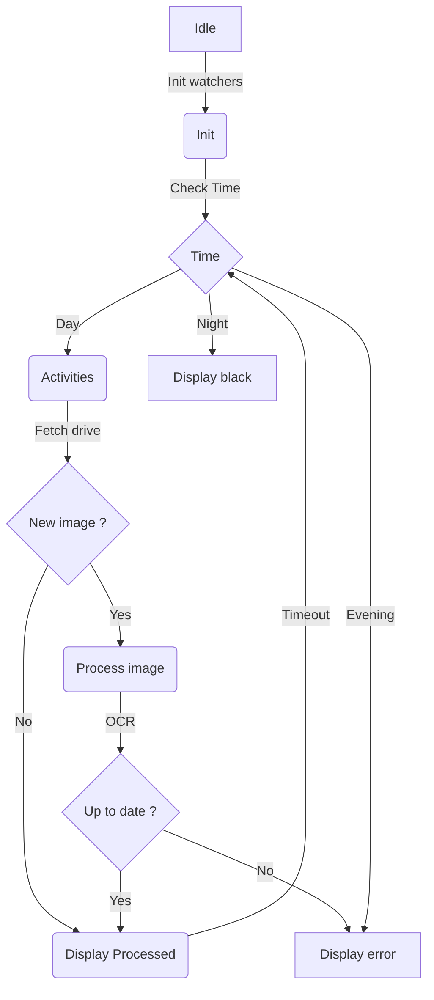

cp <filepath/filename.pdf> ./schedule.pdf  
or  
upload file to google drive

python3 -m venv venv

source venv/bin/activate

sudo apt install tesseract-ocr tesseract-ocr-fra
pip install -r requirements.txt
playwright install chromium

# Start the authenticated feed watcher in a separate terminal first.
python ./watcher.py

# Start the fullscreen activity display in another terminal.
python3 ./activities.py



The activity display checks Drive on each 10-second cycle. Weekdays from 07:00
through 19:59 display the schedule; 20:00-21:59 display an error; 22:00-06:59
and weekends display black. A newly processed schedule stays in the error state
until a later PDF passes the date OCR check. The feed watcher is a separate
process because it owns the authenticated Chromium session.

# Test
```
PYTEST_DISABLE_PLUGIN_AUTOLOAD=1 /home/py/Activities/venv/bin/python -m pytest -q tests/test_watcher.py
```