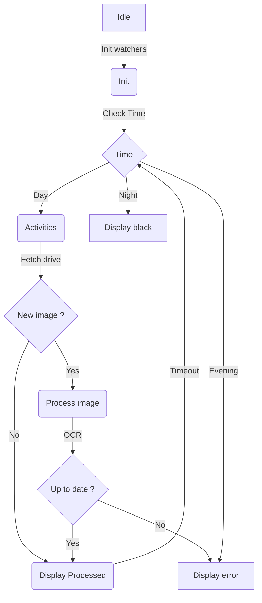

cp <filepath/filename.pdf> ./schedule.pdf  
or  
upload file to google drive

python3 -m venv venv

source venv/bin/activate

sudo apt install tesseract-ocr tesseract-ocr-fra
pip install -r requirements.txt
playwright install chromium

# Install and start the systemd services independently. On the watcher's first
# run, complete the sign-in in the Chromium window.
sudo cp services/watcher.service services/activities.service /etc/systemd/system/
sudo systemctl daemon-reload
sudo systemctl enable --now watcher.service
sudo systemctl enable --now activities.service

## Alternative: run manually

Instead of starting the systemd services, run each process in a separate
terminal. On the watcher's first run, complete the sign-in in the Chromium
window.

```sh
# Terminal 1: authenticated feed watcher
python ./watcher.py
```

```sh
# Terminal 2: fullscreen activity display
python3 ./activities.py
```



The activity display rechecks the time and Drive after each 10-minute display
timeout. Weekdays from 07:00 through 19:59 display the schedule; 20:00-21:59
display an error; 22:00-06:59 and weekends display black. A newly processed
schedule stays in the error state until a later PDF passes the date OCR check.
The feed watcher is a separate process because it owns the authenticated
Chromium session.

# Test
```
PYTEST_DISABLE_PLUGIN_AUTOLOAD=1 /home/py/Activities/venv/bin/python -m pytest -q tests/test_watcher.py
```